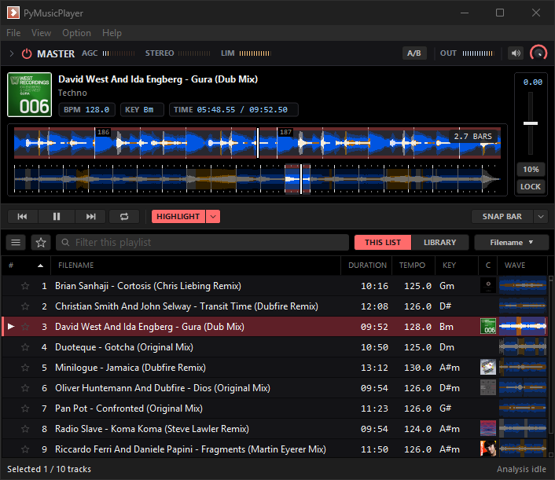
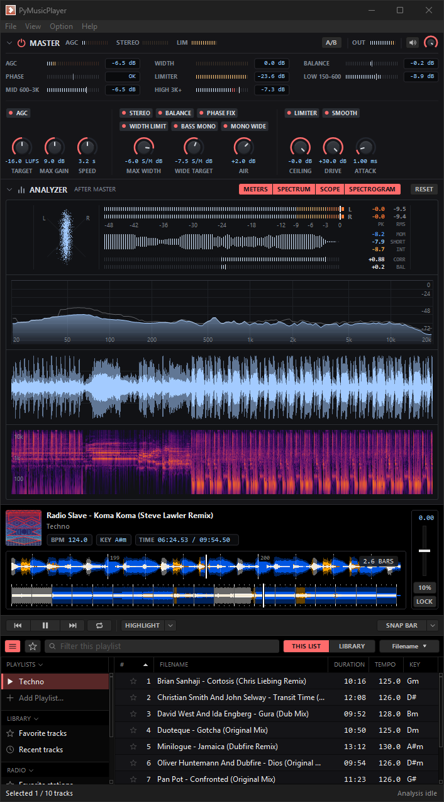

## Features

* A music player for Windows on wxPython and the un4seen BASS audio library.
* Plays MP3, MP2, WAV, OGG and AIFF; M4A, MP4 and AAC through the BASS_AAC add-on, fetched when the player first starts; FLAC, APE, WMA and AC3 when their BASS add-on is put in assets/dlls. Internet radio streams over HTTP, HTTPS and HLS.
* Drag files, folders or M3U playlists onto the list. Export Tracklist writes the playlist as M3U.
* The whole song's waveform is the seek bar, coloured by its low, mid and high bands. A zoomed waveform under it follows the play position with its zoom and the bar numbers; dragging it scrubs like a record or seeks (Preference > Zoomed Waveform Drag). SNAP puts a click on the beat, the bar or four bars.
* Over the waveforms: the album image, the title and folder, and the tempo, key and time.
* Every song is analysed in background processes: tempo, key, loudness, the highlight (the song's main part), and a beat grid with bar lines and downbeats. Results are kept in an SQLite cache, so a song is analysed once. A mark beside a row shows it waiting or being analysed. DeepRhythm checks the tempo's octave and Beat This! finds the downbeats when they are installed (both optional in requirements.pip).
* Keys in flat, sharp or Camelot notation, and the tempo and key can be written to the ID3 tag.
* Play lengths: HIGHLIGHT plays only each song's highlight, 4 to 32 bars long, then moves to the next; SHORT plays an edit of about 2:00, 2:30 or 3:00 cut on bar lines, keeping the highlight. LOOP repeats the song, and Skip Silence starts each song where its sound begins.
* A pitch fader for the tempo (±6, 10, 16 or 100%) with a key lock, and a key shift in semitones (View > Tempo Control, Key Control).
* MASTER: Auto Master (automatic gain, stereo width and a limiter, a VST built from `plugin/`) on songs and radio, with its meters and knobs in the rack over the player.
* ANALYZER: peak and RMS meters, momentary, short-term and integrated loudness, a goniometer with correlation and balance, a spectrum, an oscilloscope and a spectrogram.
* A sidebar in sections that fold: Playlists (Add Playlist at their end), Library (favorite and recent tracks, search results), Radio and Folders; the list that is playing is marked ▶. The search row filters this list by a column or searches every playlist, and its star shows only the favorite tracks. Find in Library searches by text, tempo range (with half and double tempo), key (with its compatible keys) and genre; Find Similar ranks the library by tempo, key and sound. Cover and waveform columns, row heights, and columns that are shown, hidden and resized from the header.
* Folders: add a folder to the sidebar and browse it in the list as in a terminal, with `..`, its subfolders and its songs. Enter or a double click opens a folder, Backspace or the mouse's back button goes up, and each folder keeps its scroll and selection; a folder holding the playing song shows ▶. A folder's songs stay out of the library and are analysed as they are played, or all of them when Auto Analyze Folder is checked on its root.
* Dragged songs show their covers stacked with their count; dropped on Favorite tracks they are starred. The context menu key and Shift+F10 open a row's menu.
* Track editor for tags and the cover image: choose a file or drop one, remove it, or look it up; Fix scan straightens a scanned cover and trims its rim, and Square crops to the subject. The file's modified date can be kept.
* Look Up finds tags and covers on Discogs and Last.fm, and identifies a song by its sound with AcoustID (fpcalc is fetched when the player starts). Keys of your own go in Preference > Web Services.
* Internet radio: Favorites and Browse stations, from the radio-browser.info directory by top votes, genre or country. A station plays as a playlist row and shows the stream's title.
* Check File Consistency finds moved or deleted files, and Check Analyzer Versions analyses again the songs an older version analysed.
* Editable keyboard shortcuts, Always On Top, and a blue or red accent colour.
* Opening an audio file while the player runs hands it to the running player.
* Checks GitHub once a day for a new release and shows its notes over the playlist, with Skip this version, Later and Update now. The installed player downloads and runs the new installer; a clean checkout of the main branch pulls it with git. Turn it off in Preference > General, or check now from Help > Check for Updates.

## Screenshot

<!--
## Demo on YouTube

-->

## How to install

* Just download and install the latest release.
* Alternatively, if you like to build your own, download or clone a repository then execute makebuild.py. Python 3.x, Python packages in the requirements.pip file, PyInstaller and Inno Setup are required.
* To run from the source, install Python packages in the requirements.pip file, then execute source/main.pyw with pythonw.exe, or pymp.exe, which runs it from the repository's .venv.
* `pythonw.exe source/main.pyw path/to/track.mp3` plays a song, in the running player when there is one.

## Supported platforms

* Microsoft Windows 10, Windows 11

## License

The code in `source/` is released under the MIT license, see [LICENSE](LICENSE).

Third-party binaries and assets bundled in this repository — including BASS (un4seen),
BASS_VST (GNU LGPL v3) and GNU Unifont — are **not** covered by that license and remain under
their own terms. fpcalc and BASS_AAC are fetched when the player
starts. See [THIRD-PARTY-NOTICES.md](THIRD-PARTY-NOTICES.md) for the
full list, and `licenses/` for the license texts.
